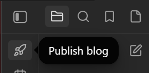
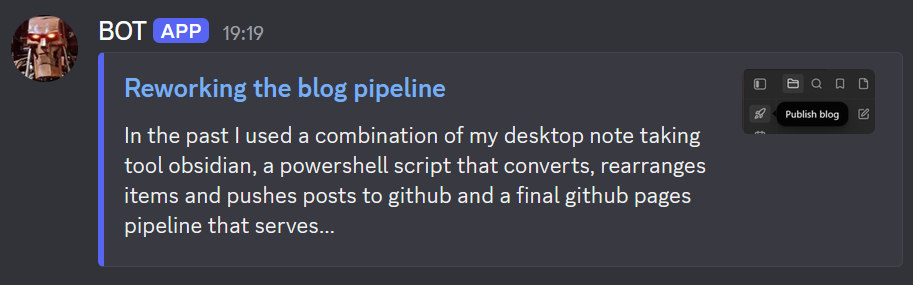

## Reducing friction

In the past I used a combination of my desktop note taking tool obsidian, a powershell script that converts, rearranges items and pushes posts to github and a final github pages pipeline that serves the website as a jekyll blog.

As posting public entries is essential in continuing forward (as it worked in the past), I thought about what friction exists, as I stopped posting as soon as I had no project to work on. As dumb as it sounds, running the powershell script manually on my system was too much of an annoyance to me. Also, starting up a 2 minute timer and opening a blog entry to write in was my routine. This allowed me to continue to work on stuff day after day. And almost every time I continued working after surpassing my artificial timer of 2 minutes.

The blogging itself should not be an obstacle, but a support structure. And for that to work any kind of friction needs to be removed. So I migrated that powershell script to github.

### Old workflow

### New workflow

 Also, I created a custom plugin for obsidian, which allows me to "publish to blog" if I want to. No powershell any more, and no path changes that break a script.

## Sharing new posts

I implemented a discord Webhook for future use, as RSS seems dead to me. This is now part of the github pipeline which picks the most current blog entry and uses the last picture in the post as a thumbnail.

New entries get announced by the Webhook, but if I remove or update posts nothing gets announced. This is useful for small blog fixes and removing legacy entries. Nobody needs to have notifications for that.

## Personal update

On a somewhat unrelated note, I've also been looking for something new to work on. This one seems interesting as I did the pong challenge 2 years back:

[https://itch.io/jam/20gameschallenge-autumn-2026](https://itch.io/jam/20gameschallenge-autumn-2026)

